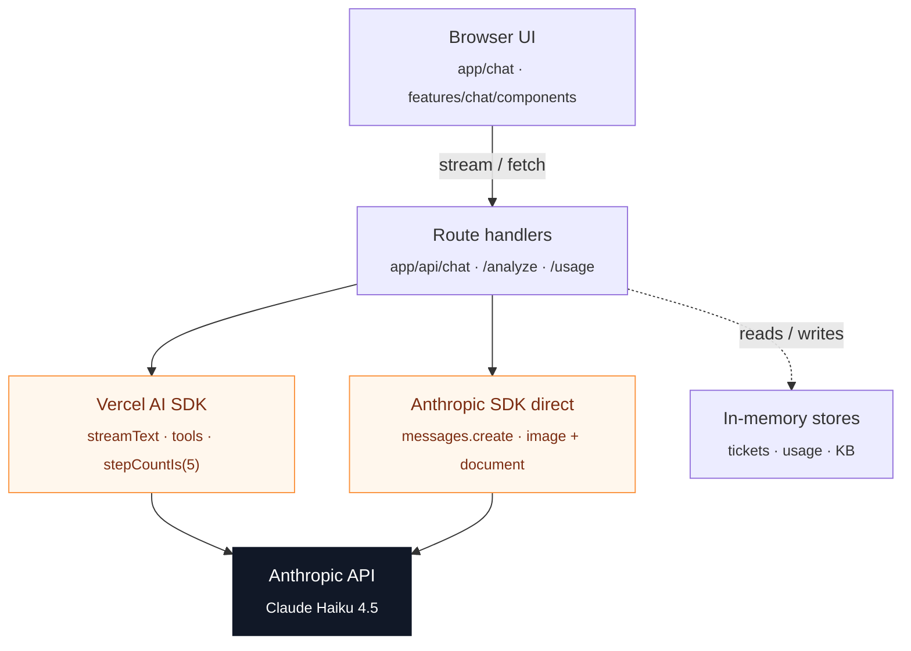

# TaskFlow AI Support Agent

> Streaming support agent with tool calling, vision, and per-turn cost tracking.

🏢 **Built by [Drembyte](https://drembyte.com)** — production AI engineering for US startups and SaaS teams · 💻 **[Source on GitHub](https://github.com/drembyte/ai-support-agent-v1)**

---

## The problem it solves

Customer support teams need to triage tickets, answer product questions from a knowledge base, and inspect screenshots and PDFs that users attach — without making the agent feel slow or opaque. This project is a production-style support assistant for a fictional SaaS ("TaskFlow") that streams answers token-by-token, takes real actions through tools (search KB, list/read/create tickets), and accepts image and PDF attachments alongside chat. It is a public reference build of the patterns we use when shipping an LLM feature end-to-end for clients.

---

## AI techniques demonstrated

| Technique | Implementation | Where to look |
|-----------|----------------|---------------|
| Streaming chat | UI-message stream over SSE via `streamText`, consumed by `useChat` on the client | `app/api/chat/route.ts`, `features/chat/components/ChatWindow.tsx` |
| Tool calling (agentic loop) | Multi-step agent with KB search and ticket CRUD tools, capped by `stepCountIs(5)` | `app/api/chat/route.ts`, `features/knowledge-base/search.ts`, `features/tickets/store.ts` |
| File analysis (vision + PDF) | Image and PDF attachments routed through the Anthropic SDK directly using `image` and `document` content blocks | `app/api/analyze/route.ts`, `shared/lib/anthropic.ts` |
| Cost & usage tracking | Fire-and-forget `result.usage.then(...)` records token counts and USD per turn without blocking the stream | `shared/lib/cost.ts`, `shared/lib/usage-tracker.ts`, `app/api/usage/route.ts` |

---

## Stack

- **Framework:** Next.js 16 (App Router, Turbopack, Route Handlers)
- **Runtime:** React 19, TypeScript 5
- **AI — streaming & tools:** Vercel AI SDK v6 (`ai`, `@ai-sdk/anthropic`, `@ai-sdk/react`)
- **AI — file analysis:** `@anthropic-ai/sdk` used directly
- **Model:** Claude Haiku 4.5
- **Persistence:** In-memory stores (tickets, usage, KB markdown) — `globalThis`-backed for reference-build scope
- **Styling:** Tailwind CSS 4

---

## Architecture



- **Dual-SDK by design.** The Vercel AI SDK owns the chat route — it abstracts SSE, drives the multi-step tool loop, and integrates with `useChat`. The Anthropic SDK is called directly from the analyze route, where `image` and `document` content blocks are first-class.
- **Folder boundaries are enforced.** `app/` is routing only; feature logic lives in `features/<name>/`; cross-feature primitives (clients, pricing, types) live in `shared/`. Route handlers never import other route handlers.
- **Types are centralized.** Domain types live in `shared/types/<domain>.ts` (`ticket.ts`, `usage.ts`, `chat.ts`) so feature files import rather than redeclare them.
- **Stateless by default.** All persistence is in-memory and intentionally swappable — the store interfaces (`TicketStore`, `UsageStore`) make a Postgres or Supabase implementation a drop-in.

---

## Notable engineering decisions

### Two SDKs by design

The Vercel AI SDK is the right abstraction for streaming chat and the agent loop: it speaks the SSE UI-message protocol, runs the multi-step tool execution, and pairs cleanly with `useChat`. For file analysis the lower-level `@anthropic-ai/sdk` is more honest — `messages.create` with `image` and `document` content blocks needs none of the wrapper indirection, and the analysis lands as a regular assistant message in the same conversation. Mixing both inside one route handler is explicitly disallowed (`AGENTS.md`); each route picks one SDK and stays with it.

### Fire-and-forget cost tracking

Cost recording must not delay the first token to the user. The chat route awaits `result.usage` inside a detached `.then(...)` that runs after the stream resolves, then writes a `UsageRecord` via `recordUsage()` in `shared/lib/usage-tracker.ts`. The stream is never blocked by pricing math, and `app/api/usage/route.ts` exposes the aggregated summary on demand.

### In-memory store as a deliberate scope choice

Tickets, usage, and the KB live in `globalThis`-backed in-memory stores rather than Postgres. For a reference build this keeps setup to one env var and removes every moving part that doesn't teach an AI pattern. The store interfaces in `shared/types/` are written so a Supabase backend slots in without touching the route handlers.

---

## Run locally

```bash
git clone https://github.com/drembyte/ai-support-agent-v1
cd ai-support-agent-v1
npm install
cp .env.example .env.local  # fill in ANTHROPIC_API_KEY
npm run dev
```

Open <http://localhost:3000>.

Required environment variables:

- `ANTHROPIC_API_KEY` — used by both the Vercel AI SDK chat route and the direct Anthropic SDK file-analysis route

---

## What's next

- [ ] Replace the in-memory tickets/usage stores with a Supabase Postgres backend behind the existing store interfaces
- [ ] Add authentication so tickets are scoped per user instead of shared across the demo
- [ ] Wire LLM observability (Langfuse or similar) for trace-level inspection of tool calls and prompt caching hit rate

---

## About

Built by **Julian Lopez** — AI Engineer · Full Stack.
Built by [Drembyte](https://drembyte.com) · Need something like this in your product? [Book a free 30-min call](https://cal.com/drembyte/discovery-call?utm_source=github&utm_medium=readme&utm_campaign=ai_support_agent)

License: MIT
