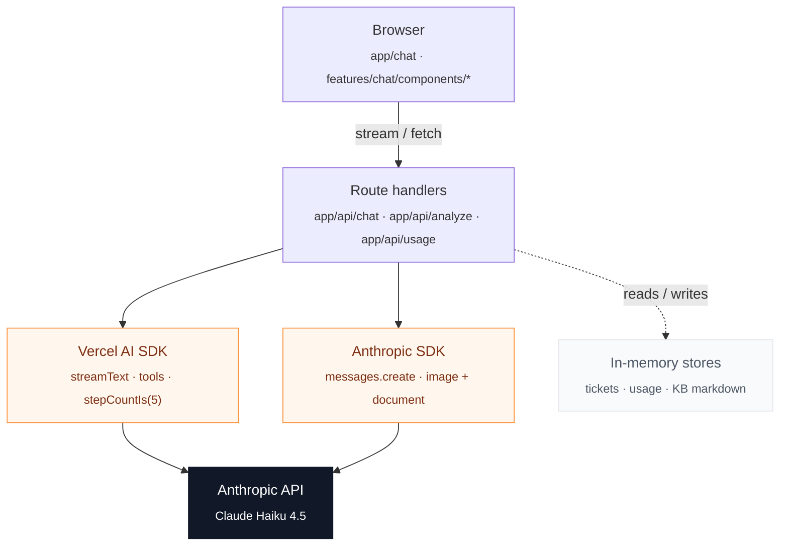

# TaskFlow AI Support Agent

A production-style customer support agent that showcases the patterns I reach for when shipping LLM features: streaming chat, tool-calling agents, file analysis with vision models, and per-turn cost tracking.

Built on Next.js 16 (App Router) with the Vercel AI SDK v6, the Anthropic SDK, and Tailwind v4.

> **Portfolio project** — Julian Lopez · AI Engineer

---

## AI techniques demonstrated

| Technique | What it does here | Where to look |
| --- | --- | --- |
| **Streaming chat** | Token-by-token responses over Server-Sent Events. The chat route returns a UI-message stream consumed by `useChat`. | `app/api/chat/route.ts`, `features/chat/components/ChatWindow.tsx` |
| **Tool calling (agentic loop)** | Multi-step assistant that searches the knowledge base, lists and reads tickets, and creates new ones. `stepCountIs(5)` caps the agent loop. | `app/api/chat/route.ts` |
| **File analysis** | Image and PDF attachments routed through the Anthropic SDK directly. The analysis lands as an assistant message in the same conversation. | `app/api/analyze/route.ts`, `features/chat/components/ChatWindow.tsx` |
| **Cost & usage tracking** | Every chat turn records token usage and USD cost via a fire-and-forget `result.usage.then(…)` so the stream is never blocked. | `shared/lib/cost.ts`, `shared/lib/usage-tracker.ts`, `app/api/usage/route.ts` |

---

## Stack

| Area | Choice |
| --- | --- |
| Framework | **Next.js 16** (App Router, Turbopack, Route Handlers, Server Components) |
| Runtime | React 19, TypeScript 5 |
| AI — streaming & tools | Vercel AI SDK `ai` v6 + `@ai-sdk/anthropic` + `@ai-sdk/react` |
| AI — file analysis | `@anthropic-ai/sdk` used directly |
| Model | Claude Haiku 4.5 |
| Styling | Tailwind CSS 4 |
| Tooling | ESLint 9 |

### Why two SDKs?

The Vercel AI SDK is the right tool for streaming chat and the agent loop — it abstracts the SSE protocol, drives multi-step tool execution, and integrates with `useChat` on the client. The Anthropic SDK is used directly for file uploads, where the lower-level `messages.create` surface with `image` and `document` content blocks is more convenient than going through the AI SDK wrapper.

---

## Architecture



State lives in `globalThis`-backed in-memory stores — fine for a portfolio demo, easy to swap for Postgres later.

---

## Setup

```bash
git clone https://github.com/stivenslop2/ai-support-agent-v1
cd ai-support-agent-v1
npm install
cp .env.example .env.local
# Fill in ANTHROPIC_API_KEY
npm run dev
```

Then open http://localhost:3000.

---

## Scripts

| Script | Description |
| --- | --- |
| `npm run dev` | Start the dev server |
| `npm run build` | Production build |
| `npm start` | Run the production build |
| `npm run lint` | Lint the project |

---

## Project layout

```
app/
  layout.tsx, globals.css
  page.tsx                          # Home — portfolio showcase
  chat/page.tsx                     # Chat UI mount
  api/
    chat/route.ts                   # POST — streaming agent (Vercel AI SDK)
    analyze/route.ts                # POST — file analysis (Anthropic SDK)
    usage/route.ts                  # GET  — token usage and cost summary

features/
  chat/
    components/                     # ChatWindow + focused presentational pieces
  knowledge-base/
    search.ts                       # Keyword search over product KB
    data/product.md                 # KB content the agent quotes back
  tickets/
    store.ts                        # In-memory ticket store

shared/
  lib/
    anthropic.ts                    # Anthropic SDK client
    cost.ts                         # Per-model pricing and cost calculator
    usage-tracker.ts                # In-memory usage records
  types/
    ticket.ts                       # Ticket, TicketPriority, TicketStatus, TicketStore
    usage.ts                        # UsageRecord, UsageStore, UsageSummary, ModelPricing
    chat.ts                         # ChatMessage type alias
```

Routes under `app/` are thin wrappers; feature logic lives under `features/<name>/` and shared primitives under `shared/`.

---

## Environment variables

| Name | Required | Purpose |
| --- | --- | --- |
| `ANTHROPIC_API_KEY` | ✅ | Used by the Vercel AI SDK chat route and the direct Anthropic SDK file-analysis route |

---

## License

MIT
